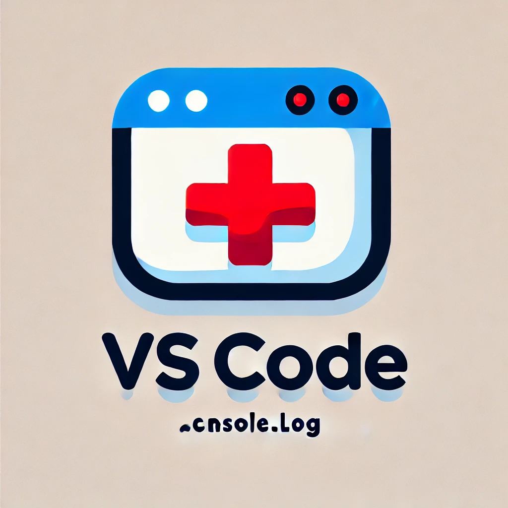

<div align="center">



# Console Log X-Ray

**See every `console.log` in a file before it ships.**

[Install from the Marketplace](https://marketplace.visualstudio.com/items?itemName=consolelogxray.console-log-xray) · [Usage](#usage) · [Develop locally](#develop-locally)

[](https://marketplace.visualstudio.com/items?itemName=consolelogxray.console-log-xray)
[](https://marketplace.visualstudio.com/items?itemName=consolelogxray.console-log-xray)


</div>


## Why

Stray `console.log` calls are easy to miss in a long file and easy to ship by accident. Console Log X-Ray marks every one of them in red, in the editor and in the scrollbar, so you can find and remove them in seconds.

## Features

- **One shortcut to toggle.** Press <kbd>Cmd</kbd>+<kbd>Shift</kbd>+<kbd>L</kbd> on macOS or <kbd>Ctrl</kbd>+<kbd>Shift</kbd>+<kbd>L</kbd> on Windows and Linux.
- **Hard to miss.** Each call gets a red background and border, plus a hover message.
- **Scrollbar markers.** Red marks in the overview ruler show where every log is, even off screen.
- **Live updates.** While highlighting is on, it refreshes as you type, so new logs light up and deleted ones disappear.
- **Spacing-tolerant.** Matches `console.log(...)` as well as `console . log (...)`.
- **Tiny and dependency-free.** No runtime dependencies and no configuration.

## Usage

1. Open a file.
2. Press <kbd>Cmd</kbd>/<kbd>Ctrl</kbd>+<kbd>Shift</kbd>+<kbd>L</kbd>, or run **Console Log Xray: Find Console.log Statements** from the Command Palette.
3. Every `console.log` is highlighted and a notification says *Console.log scanning enabled*.
4. Remove what you don't need. Press the shortcut again to turn highlighting off.

| Command | macOS | Windows / Linux |
| --- | --- | --- |
| `Console Log Xray: Find Console.log Statements` (toggle) | <kbd>Cmd</kbd>+<kbd>Shift</kbd>+<kbd>L</kbd> | <kbd>Ctrl</kbd>+<kbd>Shift</kbd>+<kbd>L</kbd> |

> [!NOTE]
> <kbd>Cmd</kbd>/<kbd>Ctrl</kbd>+<kbd>Shift</kbd>+<kbd>L</kbd> is also VS Code's built-in **Select All Occurrences** shortcut, and the extension takes it over. To use a different key, open **Keyboard Shortcuts** (<kbd>Cmd</kbd>/<kbd>Ctrl</kbd>+<kbd>K</kbd> <kbd>Cmd</kbd>/<kbd>Ctrl</kbd>+<kbd>S</kbd>), search for `console-log-xray.scan`, and set your own.

### Known limitations

- Switching files doesn't trigger a scan. The new file is highlighted as soon as you edit it, or you can toggle off and on again.
- Only `console.log` is matched, not `console.warn`, `console.error` and so on.
- The match ends at the first `)`, so a call like `console.log(fn(x), y)` is only partly highlighted.

## Installation

1. Open the Extensions view in VS Code (<kbd>Cmd</kbd>/<kbd>Ctrl</kbd>+<kbd>Shift</kbd>+<kbd>X</kbd>).
2. Search for **Console Log X-Ray**, or open the [Marketplace page](https://marketplace.visualstudio.com/items?itemName=consolelogxray.console-log-xray).
3. Click **Install**.

Or from a terminal:

```bash
code --install-extension consolelogxray.console-log-xray
```

## How it works

The extension is two small files:

- [`src/extension.ts`](src/extension.ts) registers the toggle command and, while highlighting is on, listens for document changes to re-scan the active editor.
- [`src/highlighter.ts`](src/highlighter.ts) runs the regex `/console\s*\.\s*log\s*\([^)]*\)/g` over the document text and applies a single `TextEditorDecorationType` (red background, red border, red overview-ruler mark) to every match.

## Develop locally

You need Node.js 20+ and VS Code 1.96 or newer.

```bash
git clone https://github.com/Stroller15/console-log-xray.git
cd console-log-xray
npm install
npm run watch
```

Press <kbd>F5</kbd> in VS Code to open an **Extension Development Host** window with the extension loaded. Reload that window (<kbd>Cmd</kbd>/<kbd>Ctrl</kbd>+<kbd>R</kbd>) to pick up changes.

| Command | What it does |
| --- | --- |
| `npm run compile` | Bundle with webpack into `dist/` |
| `npm run watch` | Rebuild on every change |
| `npm run package` | Production bundle, used before publishing |
| `npm run lint` | ESLint over `src/` |
| `npm test` | Compile, lint and run the tests in VS Code |

To build a `.vsix` you can install by hand:

```bash
npx @vscode/vsce package
```

## Contributing

Bug reports and pull requests are welcome. Good first contributions would be scanning every visible editor, re-scanning when you switch files, and a setting for which `console` methods to highlight.
